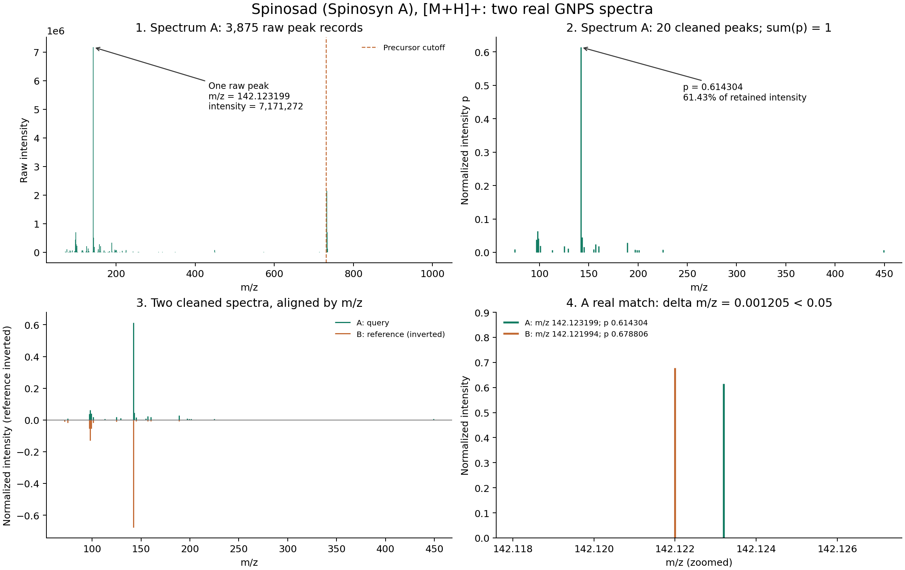

# A step-by-step walkthrough of a real compound: Spinosyn A

This walkthrough follows a real Spinosyn A pair through peak matching and entropy calculations. It uses decimal points and commas as thousands separators.

The selected compound is **Spinosyn A**, labeled “Spinosad (Spinosyn A)” in the dataset, with molecular formula `C41H65NO10` and ion form `[M+H]+`. These are real spectra already included in the pilot's `pair_scores.csv`, rather than manually constructed peak lists.

In this MS/MS context, the term is **spectral entropy**: the entropy of the intensity distribution within one spectrum. The phrase “spectrogram entropy” in the original question refers to this quantity here; this example does not use the time-dependent representation of a spectrogram. Distinguish **spectral entropy of one spectrum**, **entropy similarity between two spectra**, and **cosine similarity between two aligned peak vectors**.

Notation: `p_i` is the normalized intensity in row i of A, `q_i` is the corresponding intensity of B, and `n` is the number of rows after peak matching.

| Role in this example | Spectrum ID | Precursor m/z | Raw peak records | Peaks after cleaning |
|---|---|---:|---:|---:|
| A — query | `CCMSLIB00001058649` | 732.468 | 3,875 | 20 |
| B — reference | `CCMSLIB00001058908` | 732.468 | 63 | 12 |

Both records are labeled Spinosyn A in the source file. This example selects a pair in advance to explain **how a score is calculated between two spectra**. The script does not search the entire library or infer a compound name directly from the peak pattern. In a search, we use A as the spectrum to identify, score it against many possible B spectra, and then evaluate or rank the candidates.

## 1. Where are the peaks and intensities?

In an MGF record, lines containing `=` are metadata. Lines containing two numbers form the peak list. For example, one raw peak from A, with numbers rounded for readability:

```text
PEPMASS=732.468
SPECTRUMID=CCMSLIB00001058649
...
142.123199    7171272
```

- **The entire line `142.123199 7171272` describes one peak.**
- **142.123199 is the m/z coordinate**: the mass-to-charge ratio of the measured fragment ion.
- **7,171,272 is the intensity**: the signal strength of that peak on the scale used in the file. It is not yet a percentage.
- On a spectrum plot, the horizontal position is m/z and the height of the line is intensity.
- `PEPMASS=732.468` is the precursor m/z, which differs from the fragment peak at m/z 142.123199.

The molecular identity cannot be determined from this single peak alone. The algorithm uses the complete peak list.

In the code, [read_mgf](../src/pilot_data.py), starting at line 46, distinguishes metadata from peaks. At line 75:

```python
peaks.append((float(fields[0]), float(fields[1])))
```

`fields[0]` is m/z and `fields[1]` is intensity. After reading, `spectrum.raw_peaks` is an N × 2 matrix; `raw_peaks[:, 0]` selects all m/z values and `raw_peaks[:, 1]` selects all intensities.

## 2. Why clean and normalize the spectrum?

The script reuses the pilot's [prepare_spectrum](../src/pilot_data.py), starting at line 132:

```python
prepare_spectrum(spectrum, config)
```

This function preserves `raw_peaks` and creates `peaks` through the following steps:

1. Remove peaks with nonfinite values or nonpositive m/z or intensity.
2. Retain m/z values no higher than `732.468 - 1.6 = 730.868`, according to the pilot's rule.
3. **Centroiding:** merge nearby peaks within one spectrum using the original cleaner and a tolerance of 0.05. Intensities are added, and the m/z coordinate is calculated as an intensity-weighted average.
4. Retain peaks with intensity at least 1% of the highest peak after centroiding.
5. Normalize the sum of the remaining intensities to 1.

Merging and filtering leave 20 peaks in A and 12 in B. The calculation uses more than just the highest peak; it also does not use three arbitrarily selected lines as a substitute for the entire spectrum.

The normalization formula is:

$$
p_i=\frac{I_i^{\mathrm{clean}}}{\sum_j I_j^{\mathrm{clean}}}
$$

Around m/z 142.123199 in A, the normalized intensity is **0.6143039**: approximately **61.43% of the total intensity retained after cleaning**. All `p_i` values in A sum to 1. This does not represent 61.43% purity or a probability that the molecule is Spinosyn A.

At the corresponding location in B, `q_i ≈ 0.6788060`. B's original intensities are on a larger scale than A's; normalization lets us compare the shapes of the distributions rather than absolute signal magnitudes.

## 3. What does matching peaks between two spectra mean?

The **centroiding** step above operates within each spectrum. **Peak matching** operates between A and B, placing their intensities into corresponding m/z groups.

For this pair, two peaks after cleaning are:

```text
A: m/z = 142.1231994629; p = 0.6143039
B: m/z = 142.1219940186; q = 0.6788060
```

Their difference is:

$$
|142.1231994629-142.1219940186|=0.0012054443 < 0.05
$$

Because this falls within the selected tolerance, the matcher places both intensities in the same row for comparison. This rule is based on m/z; it does not require equal intensities or check compound names. An m/z match does not independently confirm the fragment ion's chemical formula.

Part of the aligned table, with rounded values:

| m/z in A | m/z in B | p from A | q from B | Interpretation |
|---:|---:|---:|---:|---|
| 142.123199 | 142.121994 | 0.614304 | 0.678806 | Present in both; matched |
| 98.095154 | 98.096893 | 0.063121 | 0.128649 | Present in both; matched |
| 113.062683 | — | 0.006709 | 0 | Only A has a peak in this group |
| — | 72.059975 | 0 | 0.010631 | Only B has a peak in this group |

Peaks present on only one side are retained, with an intensity of 0 on the other side. These differences also affect similarity.

In the walkthrough code, `Step 3` calls **the original matcher used by the pilot**:

```python
matched = tools.match_peaks_in_spectra(
    query.peaks.copy(), reference.peaks.copy(), ms2_da=0.05
)
```

`matched` has three columns: a representative m/z for the group, intensity from A, and intensity from B. Matching produces **21 rows**: 11 with peaks on both sides, 9 with only A, and 1 with only B. For this fixed pair, each matched row contains one peak from each spectrum; the general upstream matcher can add multiple reference peaks into a group. The explanatory table checks the one-reference-peak-per-row condition to preserve the original coordinates.

## 4. Cosine similarity on the same aligned peak table

After matching, treat the two intensity columns as vectors:

$$
\mathbf{p}=(p_1,\ldots,p_n),\qquad
\mathbf{q}=(q_1,\ldots,q_n).
$$

Standard cosine similarity is the dot product divided by the product of the vectors' L2 norms:

$$
\operatorname{Cosine}(A,B)
=\frac{\mathbf{p}\cdot\mathbf{q}}{\|\mathbf{p}\|_2\,\|\mathbf{q}\|_2}
=\frac{\sum_{i=1}^{n}p_iq_i}
{\sqrt{\sum_{i=1}^{n}p_i^2}\sqrt{\sum_{i=1}^{n}q_i^2}}.
$$

- **Numerator:** sum the products `p_i * q_i`; peaks present on only one side contribute a product of 0.
- **Denominator:** the L2 norms of the complete vectors, including unmatched rows. Even after L1 normalization makes the total intensity equal to 1, this L2 denominator is still required.
- For nonnegative intensities and two nonzero vectors, the score lies in [0, 1]. A value of 1 means the vectors point in the same direction; 0 means they have no overlapping intensity on the aligned rows.
- Cosine is unchanged if all intensities in either spectrum are multiplied by a positive constant. It can use aligned raw intensities or the L1-normalized `p` and `q` used here.

For MS/MS, the peak assignment must be specified before calculating the score. Matchms provides assignment methods such as greedy and Hungarian matching. This example **retains the 21 rows produced by the original entropy matcher** to focus on the formula. See the [official CosineGreedy documentation](https://matchms.readthedocs.io/en/stable/api/matchms.similarity.CosineGreedy.html).

Using **all 21 rows**, rather than only the four illustrative rows in Section 3:

$$
\sum_i p_iq_i=0.4306924409,\qquad
\sum_i p_i^2=0.3898551831,\qquad
\sum_i q_i^2=0.4840131162.
$$

Therefore:

$$
\operatorname{Cosine}(A,B)
=\frac{0.4306924409}
{\sqrt{0.3898551831}\sqrt{0.4840131162}}
\approx\boxed{0.9914870083}.
$$

To reproduce this calculation from the exported CSV, run the following Python code from the `spectral-entropy-msms/` repository in the `CSCI558` environment:

```python
import csv
import numpy as np
from scipy.spatial.distance import cosine

with open("results/metrics/spinosad_walkthrough/matched_peaks.csv", newline="") as stream:
    rows = list(csv.DictReader(stream))
p = np.array([float(row["query_p"]) for row in rows])
q = np.array([float(row["reference_p"]) for row in rows])
cosine_score = np.dot(p, q) / (np.linalg.norm(p) * np.linalg.norm(q))
assert np.isclose(cosine_score, 1 - cosine(p, q))
print(f"Aligned-vector cosine similarity: {cosine_score:.10f}")
```

The result, `0.9914870083`, was calculated and checked against `1 - scipy.spatial.distance.cosine(p, q)`. This is an additional calculation in the document; `explain_spinosad_pair.py` and the existing entropy summary retain their entropy outputs.

**Standard cosine and modified cosine are different choices.** Modified cosine expands peak matching using the precursor m/z difference in addition to direct matches; see [ModifiedCosineGreedy](https://matchms.readthedocs.io/en/stable/api/matchms.similarity.ModifiedCosineGreedy.html). The cosine value above is not recorded as a modified cosine benchmark or a three-algorithm comparison on 100 queries.

## 5. Spectral entropy of one spectrum

Take the two aligned intensity columns as vectors `p` and `q`. Each vector sums to 1. The m/z values have served their role in peak matching; the entropy calculation uses the intensities in the aligned rows.

$$
S(A)=-\sum_i p_i\ln p_i
$$

Similarly, for B, `S(B) = -Σ q_i ln(q_i)`. This is Shannon entropy applied to normalized intensities. It uses the natural logarithm, so the unit is **nats**. The convention is `0 ln(0) = 0`. With k peaks of positive intensity, `0 ≤ S ≤ ln(k)`: a more evenly distributed intensity pattern has higher entropy. Higher S does not automatically indicate a better spectrum or greater similarity to another compound.

A spectrum with two normalized peaks `[0.5, 0.5]` has `S = ln(2) ≈ 0.693147`; a spectrum with one peak `[1]` has `S = 0`. Two spectra with completely different m/z coordinates can still have the same S, so comparing only `S(A)` and `S(B)` does not measure their spectral similarity. The MS/MS entropy formulation is described in [Li et al. (2021)](https://doi.org/10.1038/s41592-021-01331-z).

For the individual row around m/z 142.123:

$$
-0.6143039\ln(0.6143039)\approx0.2993291
$$

This is the contribution of **one peak**. Summing contributions from all rows gives the entropy of the full spectrum:

| Quantity | Value, in nats |
|---|---:|
| S(A) | 1.70184319 |
| S(B) | 1.22454137 |
| S(M), where M = (p + q)/2 | 1.52043659 |

In the code, `Step 4` spells out the calculation:

```python
p, q = matched[:, 1].astype(np.float64), matched[:, 2].astype(np.float64)
p, q = p/p.sum(), q/q.sum()
mixture = (p+q)/2
terms = [-xlogy(v, v) for v in (p, q, mixture)]
sa, sb, sm = [float(t.sum()) for t in terms]
manual_unweighted = 1-(2*sm-sa-sb)/np.log(4)
```

`xlogy(v, v)` calculates `v * ln(v)` and handles `v=0` using the convention `0 ln 0 = 0`. The CSV columns `minus_p_ln_p`, `minus_q_ln_q`, and `minus_m_ln_m` store each row's contributions so that you can sum them to check the result.

## 6. Entropy similarity between two spectra

For the unweighted version, first construct the mixture distribution after alignment:

$$
m_i=\frac{p_i+q_i}{2},\qquad
S(M)=-\sum_{i=1}^{n}m_i\ln m_i.
$$

Then:

$$
\operatorname{Similarity}=1-\frac{2S(M)-S(A)-S(B)}{\ln4}
$$

Substituting the values above gives approximately **0.917414**. This is a pairwise similarity score, not a Top-1 accuracy of 91.74%.

For the weighted version, calculate a separate exponent from each spectrum's initial entropy. The rule for A is:

$$
w_A=\begin{cases}
0.25+0.25S(A), & S(A)<3,\\
1, & S(A)\ge 3.
\end{cases}
$$

Apply the same rule to obtain `w_B`. Both spectra in this Spinosyn A pair have S < 3:

$$
w_A=0.25+0.25S(A)\approx0.6754608,\qquad
w_B=0.25+0.25S(B)\approx0.5561353
$$

Transform and renormalize the intensities:

$$
p_i'=\frac{p_i^{w_A}}{\sum_j p_j^{w_A}},\qquad
q_i'=\frac{q_i^{w_B}}{\sum_j q_j^{w_B}},\qquad
m_i'=\frac{p_i'+q_i'}{2}.
$$

Recalculate the entropies using **the transformed vectors**, then compute:

$$
\operatorname{Similarity}_{\mathrm{weighted}}(A,B)
=1-\frac{2S(M')-S(P')-S(Q')}{\ln4}.
$$

`Step 4` contains the complete calculation. `Step 5` calls the pilot's [score_pair](../src/run_entropy_pilot.py), starting at line 80, to compare the results:

```python
weighted, unweighted = score_pair(query.peaks, reference.peaks, 0.05)
```

Results from the original implementation:

- **Weighted: 0.8543840093.**
- **Unweighted: 0.9174141890.**

The explicit float64 calculations in the walkthrough give 0.8543845398 and 0.9174139066, respectively. Their differences from the original float32 implementation are below `5e-6`, which the script checks with an assertion. The authors' original entropy code is in [spectral_entropy.py](https://github.com/YuanyueLi/SpectralEntropy/blob/4795aff2de88942e2865ad32ce0538ebfded3b7f/spectral_entropy/spectral_entropy.py), in `_entropy_similarity` and `_get_entropy_and_weighted_intensity`.

The two scores show that these spectra share many features. For identification, this candidate must still be compared with other compounds; scoring a preselected pair alone does not establish that this candidate ranks first in the library.

Comparing the quantities in this example:

| Quantity | Number of spectra used | Value in this example | Meaning |
|---|---:|---:|---|
| Spectral entropy S(A) | 1 | 1.70184319 nats | Dispersion of A's intensities |
| Spectral entropy S(B) | 1 | 1.22454137 nats | Dispersion of B's intensities |
| Cosine on aligned rows | 2 | 0.9914870083 | Cosine of the angle between the intensity vectors |
| Unweighted entropy similarity | 2 | 0.9174141890 | Similarity based on the entropy of the mixture distribution |
| Weighted entropy similarity | 2 | 0.8543840093 | Similarity after entropy-based intensity weighting |

The three similarity scores use different measures. A higher cosine score for this pair does not establish that cosine identifies compounds more accurately than entropy. Comparing methods requires evaluation on the same query/reference set with known labels. These similarity scores are also not probabilities that two spectra represent the same compound.

## 7. One compound can have multiple spectra: can similarity group them?

One compound can have multiple spectrum records; each spectrum is a separate observation. Similarity can be used to find related spectra or form spectral clusters, but distinguish:

- **Grouping similar spectra:** based on their peak patterns and similarity scores.
- **Grouping spectra from the same compound:** requires labels or suitable identification evidence, rather than only a high score.

Examples from this pilot:

| Spectrum pair | Source structure labels | Weighted entropy similarity |
|---|---|---:|
| Spinosyn A `CCMSLIB00001058649` — Spinosyn A `CCMSLIB00001058908` | Same connectivity | 0.854384 |
| Naltrindole `CCMSLIB00000079184` — SDM25N `CCMSLIB00000079211` | Different connectivity | 0.857345 |

These values can be checked in [pair_scores.csv](../results/metrics/thomas_entropy_pilot/pair_scores.csv). Here, the pair with different connectivity scores higher than the pair with the same connectivity. Therefore, “high similarity” does not establish “the same compound,” and no universal threshold has been validated for this dataset. Precursor m/z, adduct, ion mode, and structural evidence must be considered according to the task.

**The current pipeline does not perform clustering based on similarity scores.** It derives connectivity keys from SMILES/InChIKey to provide reference labels, then evaluates whether the algorithm retrieves the correct group. Clustering would require its own definition of cluster membership, thresholds, and evaluation. A being similar to B and B being similar to C does not automatically ensure that A is similar to C.

## 8. In what order should you read the code?

Open [explain_spinosad_pair.py](../src/explain_spinosad_pair.py) and start at `main()` rather than the plotting function:

| Order | Location in the walkthrough | Related pilot/upstream function |
|---|---|---|
| 1 | `Step 1`: select the two IDs and read the MGF | `pilot_data.py`, `read_mgf`, line 46 |
| 2 | `Step 2`: prepare cleaned peaks and export raw/clean tables | `pilot_data.py`, `prepare_spectrum`, line 132 |
| 3 | `Step 3`: align peaks between A and B | `spectral_entropy.tools.match_peaks_in_spectra` |
| 4 | `Step 4`: obtain p and q; calculate entropies and similarity | Explicit calculations in the walkthrough |
| 5 | `Step 5`: compare with the original pipeline's results | `run_entropy_pilot.py`, `score_pair`, line 80 |
| 6 | After understanding the pair: inspect how candidates are retrieved | `reference_candidates` and `rank_compounds` in the pilot |

Compound names and SMILES are used to check the example pair and its labels; the `score_pair` call receives only the two peak arrays and the tolerance.

The cosine calculation in Section 4 reads the CSV separately using the code example in this document. The script's `Step 1`–`Step 5` remain the entropy walkthrough; no new matchms or modified cosine calls have been added to the pipeline.

## 9. Rerun the example and inspect the figure and tables

From the `Project` directory:

```bash
conda activate CSCI558
cd spectral-entropy-msms
python src/explain_spinosad_pair.py
```

Code, result tables, and figure labels in the repository are in English. The script writes only the walkthrough outputs and preserves the previous pilot outputs.



Read the figure in order from 1 to 4:

1. **Top left:** all raw peak records from A; the arrow identifies one peak and its raw intensity. The dashed line marks the pilot's precursor cutoff.
2. **Top right:** the 20 peaks remaining after cleaning, with normalized intensity on the vertical axis. The marked peak has p ≈ 0.614304.
3. **Bottom left:** the two cleaned spectra, with A pointing upward and B downward for comparison. B's intensities are not negative in the data.
4. **Bottom right:** a zoomed view of the two peaks around m/z 142.12. Their coordinates differ slightly but remain within tolerance, so they are matched. Their different heights are preserved in p and q.

Outputs:

- [summary.json](../results/metrics/spinosad_walkthrough/summary.json): IDs, peak counts, entropies, weights, explicit scores, and upstream scores.
- [matched_peaks.csv](../results/metrics/spinosad_walkthrough/matched_peaks.csv): the 21 aligned rows, m/z coordinates on both sides, p, q, the mixture distribution, and each row's entropy contributions.
- [PNG figure](../results/figures/spinosad_walkthrough/peak_walkthrough.png) and [SVG](../results/figures/spinosad_walkthrough/peak_walkthrough.svg).
- Complete peak tables, generated locally in `results/runs/spinosad_walkthrough/`: `query_raw_peaks.csv`, `query_clean_peaks.csv`, `reference_raw_peaks.csv`, and `reference_clean_peaks.csv`. The intensity column in a `raw` file uses the original scale; in a `clean` file it contains normalized intensities.


## 10. References for the formulas

- Spectral entropy, unweighted entropy similarity, and dynamic weighting: [Li et al. (2021), Nature Methods](https://doi.org/10.1038/s41592-021-01331-z), the [local PDF](../references/li-2021-spectral-entropy.pdf), and the [original source at the pinned revision](https://github.com/YuanyueLi/SpectralEntropy/blob/4795aff2de88942e2865ad32ce0538ebfded3b7f/spectral_entropy/spectral_entropy.py).
- Peak matching for cosine: [CosineGreedy — official matchms documentation](https://matchms.readthedocs.io/en/stable/api/matchms.similarity.CosineGreedy.html), [source](https://matchms.readthedocs.io/en/stable/_modules/matchms/similarity/CosineGreedy.html).
- Distinguishing modified cosine: [ModifiedCosineGreedy — official matchms documentation](https://matchms.readthedocs.io/en/stable/api/matchms.similarity.ModifiedCosineGreedy.html).

The values calculated specifically for Spinosyn A come from this project's local data and calculations; they are not results reported by these references.
